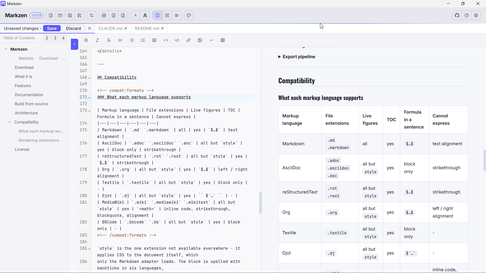

<p align="center">
  
</p>

<h1 align="center">Markzen</h1>

<div align="center">
  <strong>Write it once, hand it off as anything.</strong><br>
  Read <b>8</b> markup languages, render <b>30</b> live extensions, export to <b>20+</b> formats.
</div>

<br>

<!-- readme:nav -->

<div align="center">
  <a href="../../releases/latest"></a>
  <a href="../../releases"></a>
</div>

<h3 align="center">
  <a href="https://apps.yaiol.com/en/p/markzen/">Website</a>
  <span>&nbsp;·&nbsp;</span>
  <a href="#install">Install</a>
  <span>&nbsp;·&nbsp;</span>
  <a href="#features">Features</a>
  <span>&nbsp;·&nbsp;</span>
  <a href="#documentation">Documentation</a>
  <span>&nbsp;·&nbsp;</span>
  <a href="#compatibility">Compatibility</a>
  <span>&nbsp;·&nbsp;</span>
  <a href="#build-from-source">Development</a>
</h3>

<div align="center">
  <sub><a href="https://apps.yaiol.com/en/p/markzen/help/"><b>Help in 28 languages</b></a></sub>
</div>

<!-- /readme:nav -->

---

<p align="center">
  
</p>

---

## Install

| Windows | macOS | Linux |
|:---:|:---:|:---:|
| [](../../releases/latest) | [](../../releases/latest) | [](../../releases/latest) |
| x64 installer | Intel and Apple Silicon | portable AppImage |

> **Windows note:** SmartScreen may warn on first launch because the app is not code-signed. Click "More info", then "Run anyway".

---

## Features

Markzen is a cross-platform desktop editor for lightweight markup. You write in Markdown (or AsciiDoc, reStructuredText, Org, Textile, Djot, MediaWiki, BBCode), see a styled preview update live as you type, and export the result to any of 20+ document formats through a bundled Pandoc - without leaving the app. It is equally a **viewer**: open a file, collapse the editor pane, and read it as a rendered document.

- **Eight markup languages, read live** - Markdown, AsciiDoc, reStructuredText, Org, Textile, Djot, MediaWiki and BBCode, chosen by the file's extension, with no conversion step.
- **30 live figures from fenced code blocks** - diagrams, charts, maths, music scores, chess and Go boards, QR codes, chemical structures.
- **Export to 20+ formats** - ebook, Word, OpenDocument, PowerPoint, reveal.js, LaTeX, Typst, Jupyter - or convert straight to another markup language.
- **A real editor** - full CodeMirror with syntax highlighting, formatting shortcuts and search, beside a preview that keeps up as you type.
- **Tables without the syntax** - pick a size from a grid, or paste spreadsheet cells and get a native table.
- **Typeset typography** - separate fonts for headings, body and code, plus five style templates.
- **Table of contents** - built from your headings, always in sync, click to jump.

Every extension, every file extension and every per-language limit is listed under [Compatibility](#compatibility).

---

## Documentation

| | |
|---|---|
| **User manual** | [Read it online](https://apps.yaiol.com/en/p/markzen/help/) |
| **Printable PDF** | attached to each [release](../../releases/latest) |
| **What's new** | [Release notes](https://apps.yaiol.com/en/p/markzen/help/releases/) |
| **Product page** | [apps.yaiol.com](https://apps.yaiol.com/en/p/markzen/) |

---

## Build from source

```bash
npm install
npm run electron:dev   # React + Electron together (dev)
```

Requires Node.js 20+.

```bash
npm run dist        # Windows x64 installer
npm run dist:mac    # macOS DMG
npm run dist:linux  # Linux AppImage
```

Document export (DOCX/PDF/HTML) uses **pandoc**, which is not committed to the repo. The `dist`
commands download it automatically (into `vendor/pandoc/`) before packaging. To test export in
**dev mode**, fetch it once with `npm run ci:prepare`.

---

## Architecture

Markzen is an Electron app: a React renderer (built with Vite) over an Electron main process that also runs a small local Express server for file and export operations. There is no database - the renderer talks to the main process over local HTTP, and UI state persists in `localStorage`. The only preload exposure is a single `webUtils.getPathForFile` helper used to resolve dropped files; there is no IPC bridge.

| Layer | Technology |
|-------|-----------|
| UI framework | React 19 |
| Bundler | Vite 8 |
| Editor | CodeMirror 6 |
| Desktop shell | Electron 41 |
| Local API | Express 5 |
| Markdown rendering | showdown |
| AsciiDoc rendering | asciidoctor |
| Math | KaTeX |
| Diagrams / charts / scores | Mermaid, Chart.js, VexFlow, … (30 extensions) |
| Document export | bundled Pandoc |
| Packaging | Electron Builder |

<details>
<summary><b>Format adapters</b></summary>

The renderer is built around a **format registry** (`src/formats/index.js`). Each of the eight markup languages is an adapter - `markdown`, `asciidoc`, `rst`, `org`, `textile`, `djot`, `mediawiki`, `bbcode` - exposing a uniform interface (file extensions, editor shortcuts, a `toHtml(text)` pass, and an async `postRender(el)` pass). The active format is chosen by the open file's extension, or manually. Markdown is the default and fallback.

Rendering is two-phase: each adapter first converts source text to HTML (Markdown goes through `showdown`; the other formats through their own libraries, e.g. `asciidoctor`), then runs each registered extension's DOM render pass over the mounted preview.

</details>

<details>
<summary><b>Rendering extensions</b></summary>

The 30 extensions (`src/formats/extensions/`) turn a fenced code block - tagged with a language id after the triple backticks - into a live diagram, chart, score, math formula, or widget. They cover diagrams (Mermaid, Graphviz, Cytoscape, PlantUML, …), charts (Chart.js, Vega-Lite, ECharts, Plotly, …), math (KaTeX, AsciiMath), music notation (ABC, VexFlow, MusicXML, ChordPro), and more (chess, Go boards, QR codes, SMILES). Each extension is a small module with an HTML-injection step and a DOM render step, wired into the adapter's render chain.

</details>

<details>
<summary><b>Export pipeline</b></summary>

Export and format conversion run in the Electron main process through a **bundled Pandoc binary** (`vendor/pandoc/`, flattened into the packaged app's resources). Two surfaces use it, and what they hand Pandoc differs. *Native export* (EPUB, Word, OpenDocument, PowerPoint, RTF - the `NATIVE_EXPORT_FORMATS` list in `App.jsx`) posts the **rendered HTML**, with extension figures flattened to images, so diagrams, formulas and scores survive into the output. *Format conversion* (LaTeX, Typst, reveal.js, DocBook, JATS, Jupyter, OPML, and every markup-to-markup target) posts the document's **source text**, so an extension block lands in the output as a plain code block rather than a figure. PDF, HTML, and print are produced directly from the rendered preview (`/save-pdf`, `/save-html`, `/print`).

**BBCode is the one asymmetric format.** Pandoc can *write* BBCode (it ships six forum dialects) but has no BBCode *reader*, so the two directions take different paths: exporting **to** BBCode goes through Pandoc like everything else (using `bbcode_hubzilla`, the only dialect that preserves real `[h1]` headings, tables, rules **and** images), while *reading* a `.bbcode` file uses Markzen's own parser in `src/formats/bbcode/render.js`. Converting a `.bbcode` document **to** another format therefore hands Pandoc the already-rendered HTML instead of the source. BBCode has no specification and every forum differs, so the parser is deliberately tolerant: it accepts the common spellings side by side (`[list]`/`[ul]`, `[s]`/`[strike]`, `[h1]`/`[heading=1]`, `[code]`/`[icode]`/`[noparse]`) and leaves any tag it does not know as literal text rather than dropping it.

</details>

---

## Compatibility

<!-- compat:formats -->
### What each markup language supports

| Markup language | File extensions | Live figures | TOC | Formula in a sentence | Cannot express |
|---|---|---|---|---|---|
| Markdown | `.md` `.markdown` | all | yes | `$…$` | text alignment |
| AsciiDoc | `.adoc` `.asciidoc` `.asc` | all but `style` | yes | block only | strikethrough |
| reStructuredText | `.rst` `.rest` | all but `style` | yes | `$…$` | strikethrough |
| Org | `.org` | all but `style` | yes | `$…$` | left / right alignment |
| Textile | `.textile` | all but `style` | yes | block only | - |
| Djot | `.dj` | all but `style` | yes | `` $`…` `` | - |
| MediaWiki | `.wiki` `.mediawiki` `.wikitext` | all but `style` | yes | `<math>` | inline code, strikethrough, blockquote, alignment |
| BBCode | `.bbcode` `.bb` | all but `style` | yes | block only | - |
<!-- /compat:formats -->

`style` is the one extension not available everywhere - it applies CSS to the document itself, which
only the Markdown adapter loads. The block is spelled with backticks in six languages,
`[code=<tag>]…[/code]` in BBCode and `<syntaxhighlight lang="<tag>">…</syntaxhighlight>` in MediaWiki.

**Cannot express** is a property of the markup language, not of Markzen: where a language defines no
notation, the toolbar button is disabled rather than writing a private dialect.

<!-- compat:extensions -->
### Rendering extensions

| Category | Extension | Block tag | Engine | Notes |
|---|---|---|---|---|
| Diagrams | Mermaid | `mermaid` | mermaid 11.17.0 | flowcharts, sequence, class, Gantt, ER, state |
|  | Graphviz | `graphviz` | @hpcc-js/wasm 2.35.0 | the DOT language |
|  | Cytoscape | `cytoscape` | cytoscape 3.34.1 | network graphs; interactive |
|  | Markmap | `markmap` | markmap-lib 0.18.12 | mind map from an outline |
|  | Timeline | `timeline` | built-in | vertical event timeline |
| Software diagrams | Nomnoml | `nomnoml` | nomnoml 1.7.0 | UML |
|  | PlantUML | `plantuml` | plantuml.com | UML - **needs an internet connection** |
|  | DBML | `dbml` | @dbml/core 10.1.1 | database schema |
| Charts | Chart.js | `chartjs` | chart.js 4.5.1 | bar, line, pie, radar |
|  | Vega-Lite | `vega-lite` | vega-embed 7.1.0 | declarative charts from JSON |
|  | ECharts | `echarts` | echarts 6.1.0 | large interactive charts |
| IT development | Pseudocode | `pseudocode` | pseudocode 2.4.1 | typeset algorithms |
|  | Tabulator | `tabulator` | tabulator-tables 6.5.2 | sortable interactive table |
|  | Bytefield | `bytefield` | built-in | bit / byte field layouts |
|  | QR Code | `qrcode` | qrcode 1.5.4 |  |
|  | Railroad | `railroad` | railroad-diagrams 1.0.0 | syntax diagrams |
|  | WaveDrom | `wavedrom` | wavedrom 3.6.2 | digital timing diagrams |
| Mathematics | KaTeX | `katex` | katex 0.18.4 | also inline, per the table above |
|  | AsciiMath | `asciimath` | asciimath2tex 1.5.0 | plain-text maths |
| Graphs | function-plot | `fnplot` | built-in | function curves (custom canvas renderer) |
|  | JSXGraph | `jsxgraph` | jsxgraph 1.13.2 | interactive geometry |
|  | Plotly | `plotly` | plotly.js-dist-min 3.7.0 | scientific and 3-D charts |
| Sciences | SMILES | `smiles` | smiles-drawer 2.4.1 | chemical structures |
| Music | ABC Notation | `abc` | abcjs 6.7.0 | sheet music from plain text |
|  | VexFlow | `vexflow` | vexflow 5.0.0 | engraved staves |
|  | VexChords | `vexchords` | vexchords 1.2.0 | guitar chord diagrams |
|  | ChordPro | `chordpro` | chordsheetjs 15.6.2 | chords above lyrics |
|  | MusicXML | `musicxml` | opensheetmusicdisplay 2.1.2 | full scores |
| Games | Chess | `chess` | chess.js 1.4.0 | board from a FEN position |
|  | Go Board | `goboard` | built-in | 9x9, 13x13, 19x19 |
| Document | Markzen | `markzen` | built-in | invisible - figure placement / TOC override |
|  | Style | `style` | built-in | invisible - document-scoped CSS, **Markdown only** |
<!-- /compat:extensions -->

Both tables are hand-written and audited against the source by `scripts/check-compat.mjs`
(`npm run check:compat`), which re-derives the file extensions, TOC support, per-format extension
sets and engine versions from `src/formats/` and `package.json` and reports any drift.

---

## License

Released under the [MIT License](LICENSE).

<div align="center">
  <sub>Markzen is part of <a href="https://apps.yaiol.com">yaiol Applications</a>.</sub>
</div>
